# 🐧 Laboratorio Ubuntu Server 26.04 LTS en VirtualBox

Laboratorio de administración de sistemas Linux montado **desde cero**: instalación, almacenamiento con LVM, red, SSH con claves, usuarios y permisos, seguridad (UFW, Fail2ban, actualizaciones automáticas), servidor web Nginx, copias de seguridad automatizadas y un panel de monitorización propio en HTML.

Cada paso está documentado con capturas reales, incluidos **los problemas que encontré y cómo los resolví**.

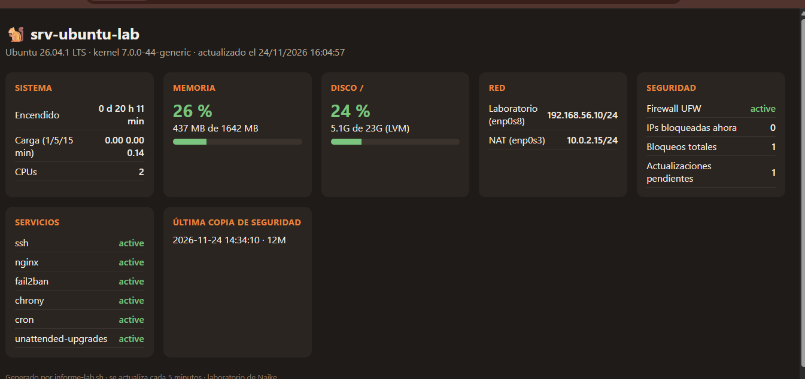

---

## 📋 Resumen

| | |
|---|---|
| **Sistema** | Ubuntu Server 26.04.1 LTS "Resolute Raccoon" · kernel 7.0 |
| **Virtualización** | Oracle VirtualBox 7.2 sobre Windows |
| **Recursos de la VM** | 2 vCPU · 2 GB RAM · disco VDI dinámico de 25 GB |
| **Servidor** | `srv-ubuntu-lab` · `192.168.56.10` |
| **Servicios** | OpenSSH · UFW · Fail2ban · unattended-upgrades · chrony · Nginx · cron |
| **Scripts propios** | [`backup-lab.sh`](scripts/backup-lab.sh) · [`informe-lab.sh`](scripts/informe-lab.sh) |

## 🗺️ Arquitectura

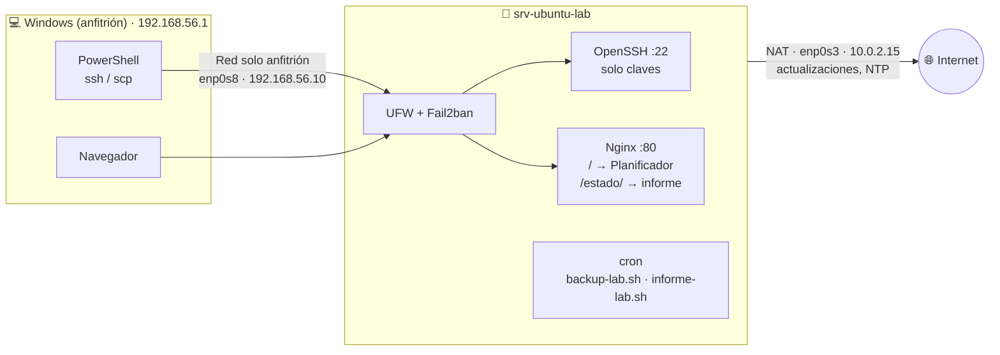

| Interfaz | Tipo en VirtualBox | IP | Uso |
|---|---|---|---|
| `enp0s3` | NAT | `10.0.2.15/24` (DHCP) | Salida a internet |
| `enp0s8` | Solo anfitrión | `192.168.56.10/24` (fija, Netplan) | Acceso desde Windows (SSH y web) |

---

## 1️⃣ Instalación

- ISO oficial de **Ubuntu Server** (sin entorno gráfico, como en producción).
- Instalación **manual** (sin instalación desatendida) para controlar cada decisión.
- Disco con **LVM** sin cifrar · **OpenSSH Server** instalado desde el instalador.

| Recursos de la VM | Particionado con LVM | Primer arranque |
|---|---|---|
| 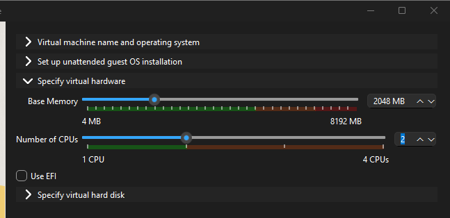 | 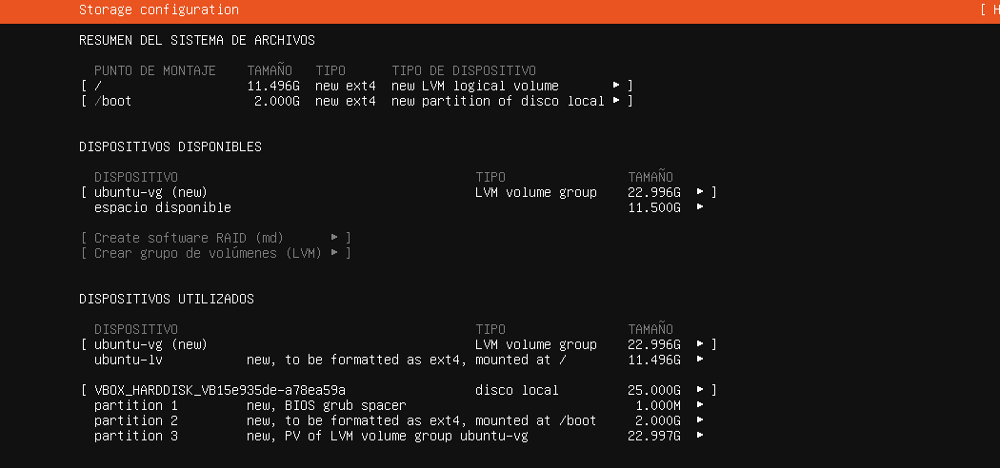 | 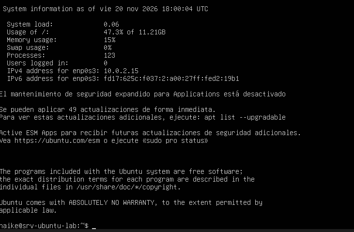 |

## 2️⃣ Almacenamiento: ampliar LVM en caliente

El instalador solo asignó **la mitad** del grupo de volúmenes al sistema. Lo amplié sin reiniciar ni desmontar:

```bash
sudo vgs                                              # VFree: 11,5 GB libres
sudo lvextend -l +100%FREE /dev/ubuntu-vg/ubuntu-lv   # amplía el volumen lógico
sudo resize2fs /dev/ubuntu-vg/ubuntu-lv               # amplía el sistema de archivos (online)
```

| Antes: 12 GB, 50 % | Después: 23 GB, 25 % |
|---|---|
| 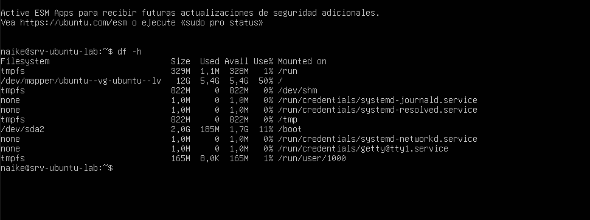 | 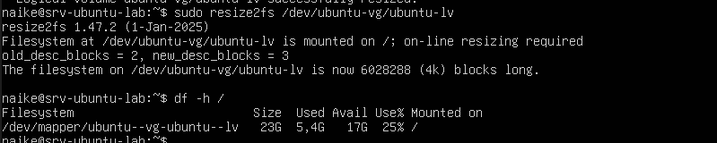 |

## 3️⃣ Red: IP fija con Netplan

- Segundo adaptador **solo anfitrión** para tener una red privada con Windows.
- IP fija `192.168.56.10`, fuera del rango DHCP de VirtualBox, en un fichero propio sin tocar el del instalador → [`config/netplan/60-hostonly.yaml`](config/netplan/60-hostonly.yaml) (permisos `600`).
- Zona horaria `Europe/Madrid` y salida a internet verificada con `curl` e `ip route`.

| Fichero Netplan | IP fija aplicada |
|---|---|
| 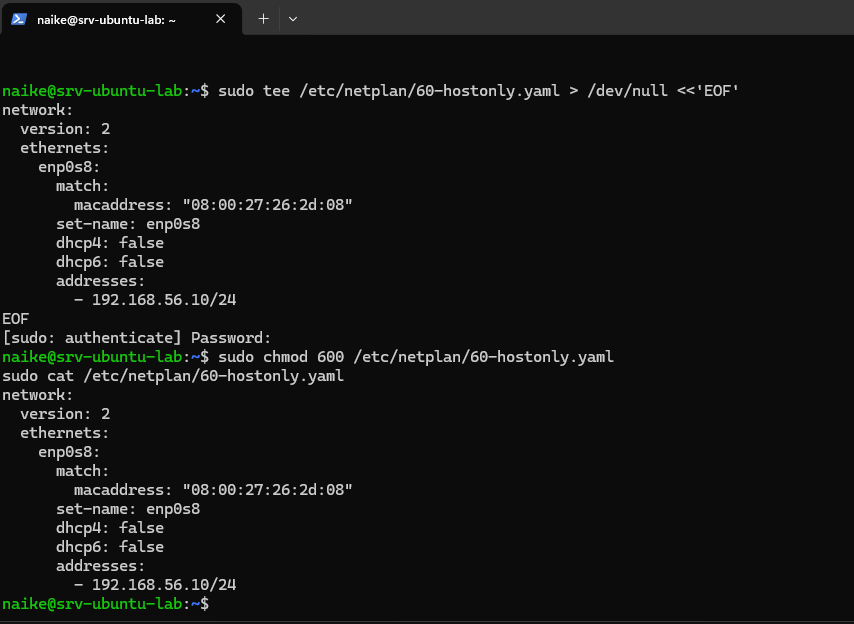 | 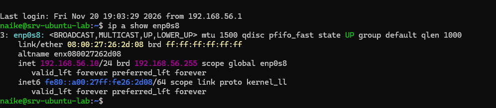 |

## 4️⃣ SSH: solo con clave

- Primera conexión **verificando la huella** ED25519 del servidor contra la mostrada en el primer arranque.
- Clave **ED25519** generada en Windows y autorizada en el servidor.
- Endurecimiento en [`config/ssh/01-hardening.conf`](config/ssh/01-hardening.conf): sin contraseñas, sin login de root. El prefijo `01-` hace que prevalezca sobre `50-cloud-init.conf`.
- **Rotación de clave** completa (clave nueva → autorizar → probar → revocar la antigua) sin perder el acceso.

| Verificación de huella | Configuración activa (`sshd -T`) | Acceso con contraseña denegado |
|---|---|---|
| 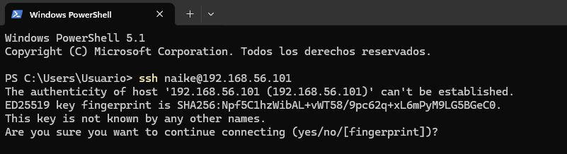 | 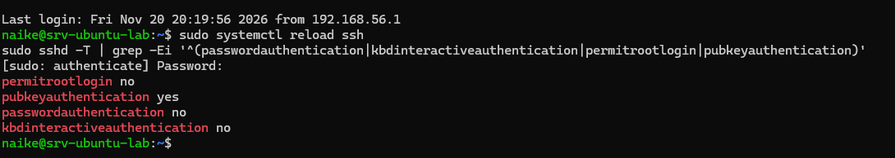 | 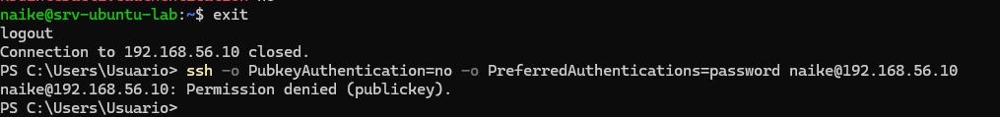 |

## 5️⃣ Usuarios, grupos y permisos

Escenario simulado de un pequeño equipo:

| Usuario | Grupos | Permisos |
|---|---|---|
| `ana` | `web` | Carpeta compartida del proyecto |
| `luis` | `web`, `operadores` | Carpeta compartida + `sudo` **solo** para `apt update` / `apt upgrade` |

- Carpeta `/srv/proyectos/web` con **setgid** (`2770`) y **ACL por defecto** (`setfacl -d -m g::rwx`) para que el equipo pueda editar los archivos de los demás.
- **Mínimo privilegio** con [`config/sudoers/operadores`](config/sudoers/operadores), validado con `visudo -c`.

| Carpeta compartida con ACL | sudo limitado: `apt` sí, `whoami` no |
|---|---|
| 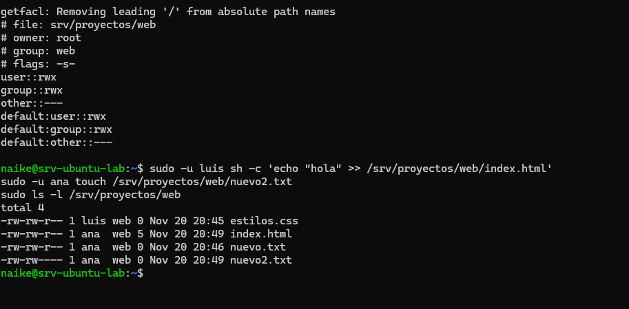 | 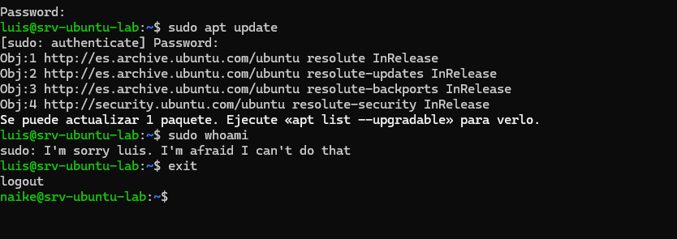 |

## 6️⃣ Seguridad: UFW, Fail2ban y actualizaciones automáticas

- **UFW**: entrada denegada por defecto; SSH (22) y HTTP (80) abiertos **solo** a la red de laboratorio.
- **Fail2ban** ([`config/fail2ban/jail.local`](config/fail2ban/jail.local)): 3 fallos en 10 min → bloqueo de 10 min **mediante UFW**. Lo probé con un ataque simulado desde Windows.
- **unattended-upgrades**: parches de seguridad diarios.

| UFW activo | Ataque simulado bloqueado | IP baneada en Fail2ban y UFW |
|---|---|---|
| 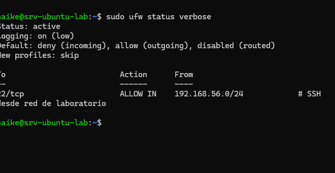 | 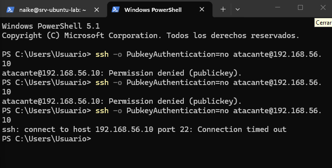 | 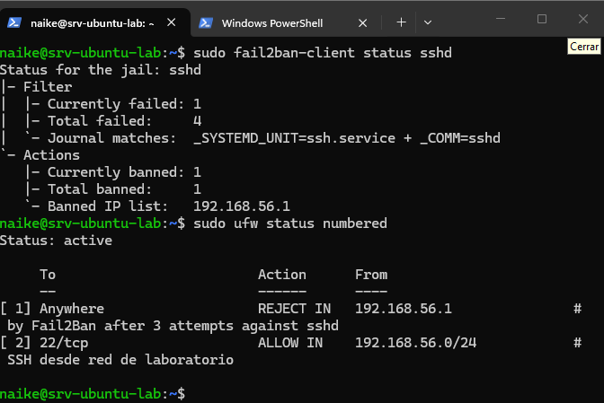 |

## 7️⃣ Servidor web Nginx

- Despliegue de mi propia aplicación web, el **Planificador** (asistente "Bellota"), copiada desde Windows con `scp`.
- Propietario `root`, carpetas `755` y archivos `644`.
- Configuración propia ([`config/nginx/planificador`](config/nginx/planificador)): `server_tokens off`, logs separados y **bloqueo de `.git`** y de archivos que no deben publicarse.

| Planificador servido por Nginx | Web `200 OK` · `.git` `403 Forbidden` |
|---|---|
|  | 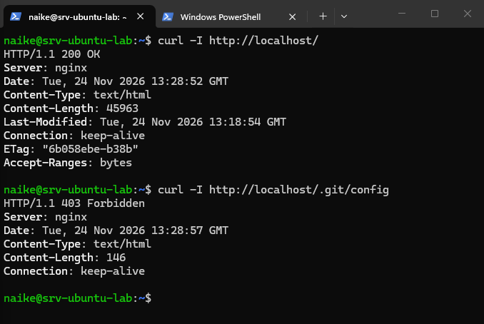 |

## 8️⃣ Copias de seguridad con rsync + cron

[`scripts/backup-lab.sh`](scripts/backup-lab.sh):

- Copia de `/etc`, `/var/www`, `/srv/proyectos` y `/home` en `/var/backups/lab/<fecha>`.
- **Incremental** con `rsync --link-dest`: lo que no cambia se enlaza con la copia anterior y no ocupa espacio.
- Retención de 7 días y registro en `/var/log/backup-lab.log`.
- Programada en [`config/cron/backup-lab`](config/cron/backup-lab): diaria a las 02:30 y también **5 minutos después de cada arranque**, porque la VM suele estar apagada de noche.

**Prueba de restauración:** borré `index.html` de la web (→ `403`) y lo recuperé desde la copia (→ `200`, mismo `ETag`: archivo idéntico).

| Web rota | Restaurada desde la copia |
|---|---|
| 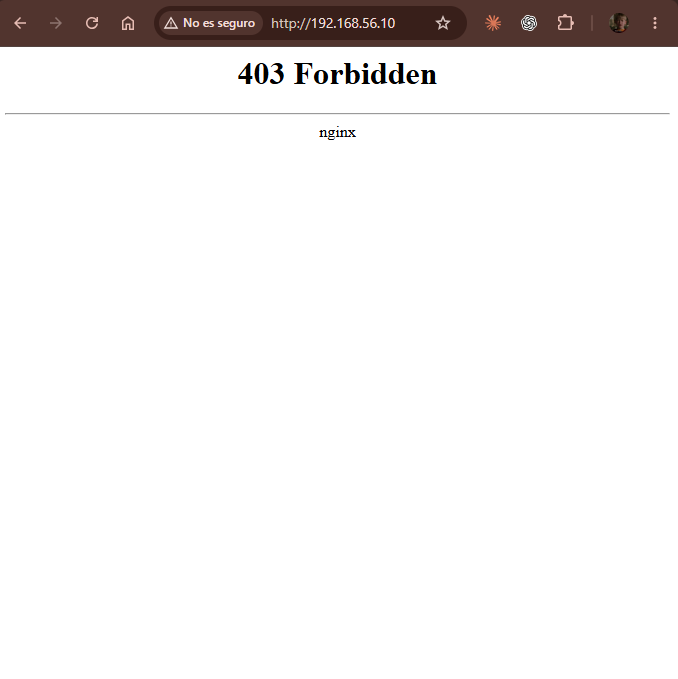 | 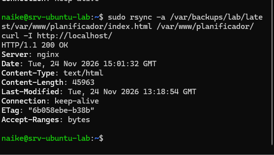 |

## 9️⃣ Monitorización: informe HTML propio

[`scripts/informe-lab.sh`](scripts/informe-lab.sh) genera cada 5 minutos (cron) una página publicada en `http://192.168.56.10/estado/` con:
sistema y carga, memoria y disco (con barras de color según umbral), red, estado del firewall, IPs bloqueadas por Fail2ban, actualizaciones pendientes, estado de los servicios y última copia de seguridad.


---

## 🔧 Problemas encontrados y soluciones

| Problema | Diagnóstico | Solución |
|---|---|---|
| `lvextend -100%FREE` → *invalid option* | Sintaxis incorrecta | `lvextend -l +100%FREE` |
| No se puede pegar texto en la consola de VirtualBox | Sin portapapeles compartido en un servidor sin GUI | Trabajar por **SSH** desde PowerShell |
| `enp0s8` recibía `192.168.56.101` dinámica | DHCP de VirtualBox | IP fija `.10` con Netplan, fuera del rango DHCP |
| `ping ubuntu.com` → 100 % de pérdida | El destino bloquea ICMP | Conectividad verificada con `curl -I` e `ip route` |
| Usuario creado con nombre completo erróneo | Comando escrito dentro de un campo de `adduser` | `chfn` para corregirlo |
| El grupo no podía editar los archivos de otros | `umask 022` crea archivos sin escritura de grupo | **ACL por defecto** con `setfacl` (instalando el paquete `acl`) |
| `sudo chmod g+w /srv/proyectos/web/*` → no existe | El `*` lo expande el shell del usuario, que no tiene acceso | `sudo sh -c '…'` |
| Passphrase de la clave SSH olvidada | Comprobado con `ssh-keygen -y -f` | **Rotación de clave** manteniendo una sesión abierta como respaldo |
| `sed '/…$/d'` no borraba una línea de `authorized_keys` | `cat -A` mostró `^M`: finales de línea de Windows (CRLF) | `sed '/…\r\?$/d'` y `sed 's/\r$//'` |
| `fail2ban-client` → *Failed to access socket* | El comando se ejecutó durante el reinicio del servicio | Esperar y comprobar con `systemctl status` |
| Reloj del servidor 78 min atrasado | VM suspendida; en 26.04 la hora la gestiona **chrony**, no `systemd-timesyncd` | `chronyc makestep`, `makestep 1 -1` ([`config/chrony/vm-lab.conf`](config/chrony/vm-lab.conf)) y `hwclock --systohc` |
| `git clone` pedía credenciales | Repositorio privado | Copia con `scp` desde Windows |

## 🧠 Lo que he practicado

`LVM` · `Netplan` · `OpenSSH` (claves, endurecimiento, rotación) · `scp` · usuarios y grupos · permisos (`chmod`, setgid, ACL) · `sudoers` · `UFW` · `Fail2ban` · `unattended-upgrades` · `chrony`/NTP · `Nginx` · `rsync` · `cron` · scripting en **Bash** · diagnóstico con `journalctl`, `systemctl`, `ss`/`ip`, `curl`, `cat -A`.

## 📁 Estructura del repositorio

```
├── README.md
├── capturas/        82 capturas numeradas en orden cronológico
├── scripts/
│   ├── backup-lab.sh     copia incremental con rsync
│   └── informe-lab.sh    informe HTML de estado
└── config/          ficheros de configuración tal como están en el servidor
    ├── netplan/60-hostonly.yaml          → /etc/netplan/
    ├── ssh/01-hardening.conf             → /etc/ssh/sshd_config.d/
    ├── fail2ban/jail.local               → /etc/fail2ban/
    ├── nginx/planificador                → /etc/nginx/sites-available/
    ├── cron/backup-lab, informe-lab      → /etc/cron.d/
    ├── sudoers/operadores                → /etc/sudoers.d/
    └── chrony/vm-lab.conf                → /etc/chrony/conf.d/
```

## 🚀 Próximos pasos

- HTTPS con certificado propio (autofirmado o CA interna).
- Gestor de contraseñas (KeePass) y rotación de credenciales.
- Copias de seguridad fuera del servidor (a otra VM o almacenamiento externo).
- Automatizar todo el laboratorio con **Ansible**.

---

*Laboratorio realizado en noviembre de 2026 como práctica de administración de sistemas, en paralelo al ciclo de Grado Superior de ASIR.*
